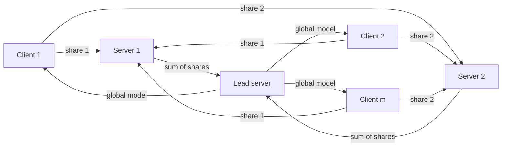

# FedShare

Official implementation of **FedShare: Secure Aggregation based on Additive Secret Sharing in Federated Learning** (IDEAS 2023). [Paper (ACM)](https://doi.org/10.1145/3589462.3589504)

In standard federated learning (FedAvg), the server sees every client's model update, and those updates can leak the clients' training data. FedShare fixes this with additive secret sharing: each client splits its model into random shares and sends one share to each of *n* servers. No single server learns anything about an individual client's model, provided at least two servers do not collude. The aggregated model is still **mathematically identical to FedAvg**, so accuracy is the same.

## How it works



1. Each client trains locally, then splits its weights *W* into *n* random shares that sum to *W*.
2. Server *j* receives share *j* from every client and adds them up. On their own, these sums look random.
3. The lead server adds the *n* partial sums, which gives exactly the FedAvg aggregate, and sends the global model back to the clients.

## Results

All numbers below come from the paper.

**Accuracy.** FedShare matches FedAvg exactly. SCOTCH, the previous state-of-the-art secure-aggregation method, falls close to random guessing at 20+ clients on MNIST, FMNIST and EMNIST.

| CIFAR-10 (CNN, 10 clients) | FedAvg | FedShare n=2 | n=3 | n=5 | n=10 |
|---|---|---|---|---|---|
| IID | 0.79 | 0.79 | 0.79 | 0.79 | 0.79 |
| Non-IID | 0.75 | 0.75 | 0.75 | 0.75 | 0.75 |

**Training time** (MNIST, 10 rounds, average of 5 runs; overhead vs. FedAvg in parentheses):

| Clients | FedAvg | SCOTCH n=2 | FedShare n=2 | FedShare n=3 | FedShare n=5 |
|---|---|---|---|---|---|
| m=10 | 66.8 s | 338.0 s (+405%) | 67.9 s (+1%) | 70.4 s (+5%) | 73.3 s (+9%) |
| m=20 | 105.9 s | 659.7 s (+522%) | 112.3 s (+6%) | 124.4 s (+17%) | 143.7 s (+35%) |
| m=30 | 155.5 s | 1104.8 s (+610%) | 168.1 s (+8%) | 173.2 s (+11%) | 187.4 s (+20%) |

**Communication.** Per-client bandwidth depends only on the number of servers, not the number of clients. FedShare uses 25% less client bandwidth than SCOTCH at n=2, and 40% less at n=5.

## Quick start

Requires Python 3.8.

```bash
git clone https://github.com/feknall/FedShare.git
cd FedShare
pip install -r requirements.txt
chmod +x start-*.sh

./start-fedshare.sh   # FedShare
./start-fedavg.sh     # FedAvg baseline
./start-scotch.sh     # SCOTCH baseline
```

Defaults: `m=5` clients, `n=2` servers, MNIST. To change them, edit `config.py` **and** `N`/`M` in the matching `start-*.sh`. To use another dataset, replace `import mnistcommon` with `emnistcommon`, `fmnistcommon` or `mhealthcommon`. Logs and training progress are written to `logs/`.

## Citation

```bibtex
@inproceedings{fazlikhojir2023fedshare,
  author    = {Fazli Khojir, Hamid and Alhadidi, Dima and Rouhani, Sara and Mohammed, Noman},
  title     = {FedShare: Secure Aggregation based on Additive Secret Sharing in Federated Learning},
  booktitle = {Proceedings of the International Database Engineered Applications Symposium Conference (IDEAS '23)},
  pages     = {25--33},
  year      = {2023},
  publisher = {ACM},
  address   = {Heraklion, Crete, Greece},
  doi       = {10.1145/3589462.3589504}
}
```

## License

MIT, see [LICENSE](LICENSE).
